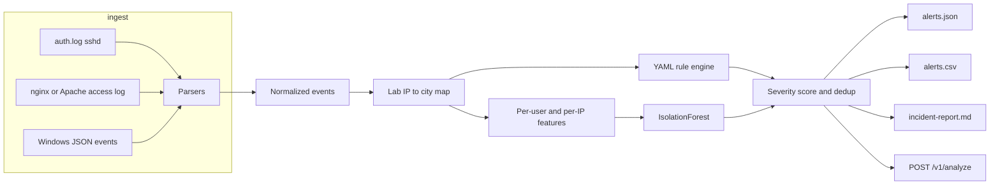

# socdetect

SOC Tier-1 log triage for a single batch of SSH, web, and Windows logon events. You point it at logs you already collected. It normalizes them, runs a small Sigma-inspired rule set, scores an IsolationForest over per-user and per-IP behavior, maps each alert to a MITRE ATT&CK technique, and writes JSON, CSV, and a Markdown incident report.

This is a portfolio project by **Alexandru Cojocari** (ISC2 certified), built to show detection engineering, log parsing, and a classical anomaly model with tests. It is a lab tool for one analyst reviewing one batch. It is not a SIEM.

[](https://github.com/DatadrivenAlex/soc-log-anomaly-detector/actions/workflows/ci.yml)

## How a batch moves



Parsers emit one event shape: time, source, host, event type, outcome, user, source IP, and a field bag (status code, URL, logon type, city). Rules and the model only see that shape. The city and coordinates come from a built-in map of RFC 5737 TEST-NET addresses, so the lab runs with no network and no GeoIP license.

## Quickstart

Requires Python 3.11+.

```bash
python -m pip install -e ".[dev]"
make generate          # data/sample, seed 42
make analyze           # reports/alerts.json, alerts.csv, incident-report.md
make test              # ruff is separate: make lint, or make ci for both
```

The generator always injects the same five attack stories. The seed only changes benign noise (ports, which safe paths a user opens) and keeps that noise under the rule thresholds. Seed 42 is the sample below.

Serve the lab API on localhost. It has no authentication.

```bash
make serve
```

```bash
curl -s http://127.0.0.1:8000/health
curl -s http://127.0.0.1:8000/v1/analyze \
  -H 'content-type: application/json' \
  -d '{"enable_anomaly": false, "records": [
    {"source": "linux_auth", "content": "Nov  3 11:00:00 lab-ssh sshd[1]: Failed password for root from 203.0.113.50 port 40000 ssh2"},
    {"source": "linux_auth", "content": "Nov  3 11:00:20 lab-ssh sshd[1]: Failed password for root from 203.0.113.50 port 40001 ssh2"},
    {"source": "linux_auth", "content": "Nov  3 11:00:40 lab-ssh sshd[1]: Failed password for root from 203.0.113.50 port 40002 ssh2"},
    {"source": "linux_auth", "content": "Nov  3 11:01:00 lab-ssh sshd[1]: Failed password for root from 203.0.113.50 port 40003 ssh2"},
    {"source": "linux_auth", "content": "Nov  3 11:01:20 lab-ssh sshd[1]: Failed password for root from 203.0.113.50 port 40004 ssh2"},
    {"source": "linux_auth", "content": "Nov  3 11:01:40 lab-ssh sshd[1]: Failed password for root from 203.0.113.50 port 40005 ssh2"},
    {"source": "linux_auth", "content": "Nov  3 11:02:00 lab-ssh sshd[1]: Failed password for root from 203.0.113.50 port 40006 ssh2"},
    {"source": "linux_auth", "content": "Nov  3 11:02:20 lab-ssh sshd[1]: Failed password for root from 203.0.113.50 port 40007 ssh2"}
  ]}'
```

Docker image (the process listens only if you pass `serve`):

```bash
docker build -t socdetect:local .
docker run --rm -p 8000:8000 socdetect:local serve --host 0.0.0.0 --port 8000
```

`socdetect analyze` accepts files or the directory from `generate`. Syslog dates have no year; `--year` defaults to 2026. `--no-anomaly` runs rules only.

## Detection catalog

Thresholds live in `socdetect/rules/*.yml`. Severity starts from each rule's base score, adds a little for volume, and adds 15 when a later authentication succeeds or a web payload returns a status below 400. Bands are low under 45, medium from 45, high from 70, critical from 90. The YAML `level` is a floor, so a short high rule cannot be reported as low. Alerts with the same rule and the same entity collapse into one; the higher score wins.

| ID | Default level | Logs | Idea | Window / grouping | ATT&CK |
| --- | --- | --- | --- | --- | --- |
| `ssh-brute-force` | high, critical if a success follows | sshd | Many failures for one account from one address | 8 failures in 10 minutes, grouped by source IP and user | [T1110.001](https://attack.mitre.org/techniques/T1110/001/) Password Guessing |
| `password-spray` | high | sshd, Windows 4625 | One address, many accounts, few tries each | At least 6 users, at most 3 failures per user, in 15 minutes | [T1110.003](https://attack.mitre.org/techniques/T1110/003/) Password Spraying |
| `impossible-travel` | high | any success with coordinates | Two successes too far apart for the gap | Faster than 900 km/h and at least 500 km, per user | [T1078](https://attack.mitre.org/techniques/T1078/) Valid Accounts |
| `web-scanning` | medium | combined access log | Many distinct paths, mostly errors | At least 12 paths and 12 responses with status ≥ 400 in 10 minutes, per source IP | [T1595.002](https://attack.mitre.org/techniques/T1595/002/) Vulnerability Scanning |
| `path-traversal` | high, critical if status &lt; 400 | combined access log | Directory traversal or `/etc/passwd` / `/etc/shadow`, after two URL decodes | All matches from one source IP | [T1190](https://attack.mitre.org/techniques/T1190/) Exploit Public-Facing Application |
| `sql-injection` | high, critical if status &lt; 400 | combined access log | `UNION SELECT`, `OR 1=1`, `information_schema`, `SLEEP(`, `BENCHMARK(`, `xp_cmdshell` | All matches from one source IP | [T1190](https://attack.mitre.org/techniques/T1190/) Exploit Public-Facing Application |
| `off-hours-admin` | high | sshd success, Windows 4624 / 4672 | Privileged success outside office hours | Before 08:00 or from 18:00 UTC on a weekday, or any time Saturday/Sunday, per user | [T1078.002](https://attack.mitre.org/techniques/T1078/002/) Domain Accounts |
| `isolation-forest` | medium or high | per-IP and per-user features | Batch outlier versus the other entities in the same file | At least 8 entities with at least 4 events each. Technique follows the dominant feature | T1110.001, T1110.003, T1595.002, or T1078 |

Privileged means the username is `root`, `admin`, or `Administrator`, or the Windows event has `ElevatedToken`, Event ID 4672, or a privilege list containing `SeDebugPrivilege`, `SeTcbPrivilege`, or `SeSecurityPrivilege`.

The rule YAML is Sigma-shaped (`logsource`, `detection.selection`, `level`, ATT&CK tags) and intentionally smaller than Sigma. Supported pieces are equality selections, a keyword or regex match, a sliding-window threshold (`min_count`, `distinct_field`, `unique_field`), an off-hours filter, and one correlation type (`impossible_travel`). There is no Sigma compiler and no conversion to Splunk, Elastic, or Microsoft 365 Defender.

The forest uses `sklearn.ensemble.IsolationForest` (`n_estimators=200`, `contamination=0.12`, `random_state` from `--seed`, one thread). IP features are failure ratio, distinct users, distinct paths, 4xx ratio, off-hours ratio, distinct countries, and `log(1 + failures)`. User features swap in distinct IPs and a privileged ratio. The dominant feature is the one furthest above the batch median, and that feature picks the technique. Do not contain on an anomaly alert by itself.

## Sample report from a real run

Command, with the report clock fixed so this file stays reproducible:

```bash
socdetect generate --out data/sample --seed 42
socdetect analyze data/sample --out reports --seed 42
```

Seed 42 produced **181 events**, **11 alerts**, **0 parse errors**, and **2 skipped syslog lines** (a CRON line and an sshd startup line). Highest severity is critical. The same Markdown is checked in at [`examples/incident-report.md`](examples/incident-report.md), next to [`examples/alerts.json`](examples/alerts.json) and [`examples/alerts.csv`](examples/alerts.csv). A test re-renders seed 42 and compares it to the Markdown file.

What the run shows, in triage order:

- SQL injection and path traversal from `203.0.113.70`, both critical because a request returned HTTP 200.
- SSH brute force of `root` from `203.0.113.50`, critical because guess 16 was `Accepted password`.
- Alice authenticates in London at 14:08 UTC and in Singapore at 14:22 UTC.
- `Administrator` RDP (logon type 10) at 02:17 UTC, while the same account's daytime logons stay quiet.
- A 12-account SSH spray from `203.0.113.60`.
- IsolationForest outliers for the scanner IP, the spray IP, `root`, and `Administrator`, plus the web-scanning rule on the same scanner.

The text below is that report, unchanged.

---

# SOC incident report

- Generated: 2026-11-03T18:00:00Z
- Events analyzed: 181
- Parse errors: 0
- Lines skipped by the auth parser: 2
- Alerts: 11
- Highest severity: critical
- Anomaly model ran: yes

## Executive summary

Rule matches and IsolationForest outliers are listed below, highest severity first. Confirmed access means a successful authentication followed credential failures, or a web payload received a status below 400.

## Severity

| Severity | Alerts |
| --- | ---: |
| critical | 3 |
| high | 3 |
| medium | 5 |
| low | 0 |

## MITRE ATT&CK

| Technique | Name | Alerts |
| --- | --- | ---: |
| [T1078](https://attack.mitre.org/techniques/T1078/) | Valid Accounts | 2 |
| [T1078.002](https://attack.mitre.org/techniques/T1078/002/) | Domain Accounts | 1 |
| [T1110.001](https://attack.mitre.org/techniques/T1110/001/) | Password Guessing | 2 |
| [T1110.003](https://attack.mitre.org/techniques/T1110/003/) | Password Spraying | 2 |
| [T1190](https://attack.mitre.org/techniques/T1190/) | Exploit Public-Facing Application | 2 |
| [T1595.002](https://attack.mitre.org/techniques/T1595/002/) | Vulnerability Scanning | 2 |

## Alerts

### ALT-C610A4EF — CRITICAL (93) — SQL injection pattern

- Rule: `sql-injection` (rule)
- Entity: src_ip=203.0.113.70
- Events: 2
- Window: 2026-11-03T15:03:30Z → 2026-11-03T15:03:48Z
- ATT&CK: [T1190 Exploit Public-Facing Application](https://attack.mitre.org/techniques/T1190/) / Initial Access
- Confirmed access: yes

A request URL matches a small set of SQL injection shapes (UNION SELECT, OR 1=1, information_schema, SLEEP, BENCHMARK, xp_cmdshell) after percent-decoding. At least one matching request returned a status below 400.

**Evidence**

```text
203.0.113.70 - - [03/Nov/2026:15:03:30 +0000] "GET /search?q=%27%20OR%201%3D1-- HTTP/1.1" 500 220 "-" "sqlmap/1.8"
203.0.113.70 - - [03/Nov/2026:15:03:48 +0000] "GET /index.php?id=1%20UNION%20SELECT%20username,password%20FROM%20users HTTP/1.1" 200 2600 "-" "sqlmap/1.8"
```

**Tier-1 action.** Treat a status below 400 as a possible successful injection and escalate with the full URL. For 4xx or 5xx responses, block the source if it is not an approved test and review the application error log.

**False-positive checks.**

- A blog or ticketing page that quotes a SQL example in a query string
- Application test fixtures that ship a literal "union select"

### ALT-C6F9F4FD — CRITICAL (91) — Path traversal

- Rule: `path-traversal` (rule)
- Entity: src_ip=203.0.113.70
- Events: 2
- Window: 2026-11-03T15:03:00Z → 2026-11-03T15:03:12Z
- ATT&CK: [T1190 Exploit Public-Facing Application](https://attack.mitre.org/techniques/T1190/) / Initial Access
- Confirmed access: yes

A web request path or query contains a directory traversal sequence or a direct read of a sensitive Unix file. The URL is percent-decoded twice before matching. At least one matching request returned a status below 400.

**Evidence**

```text
203.0.113.70 - - [03/Nov/2026:15:03:00 +0000] "GET /static/%2e%2e/%2e%2e/etc/shadow HTTP/1.1" 400 90 "-" "curl/8.5.0"
203.0.113.70 - - [03/Nov/2026:15:03:12 +0000] "GET /download?file=../../etc/passwd HTTP/1.1" 200 1400 "-" "curl/8.5.0"
```

**Tier-1 action.** Capture the response status and body size. A status below 400 on a traversal URL is a possible file read: isolate the host and escalate to Tier-2. A 4xx can stay at high while you confirm the WAF or app rejected it.

**False-positive checks.**

- An application that legitimately echoes a path containing ".."
- A security test that was scheduled and is still in window

### ALT-F9FFF090 — CRITICAL (91) — SSH brute force

- Rule: `ssh-brute-force` (rule)
- Entity: src_ip=203.0.113.50, user=root
- Events: 16
- Window: 2026-11-03T11:00:00Z → 2026-11-03T11:06:00Z
- ATT&CK: [T1110.001 Password Guessing](https://attack.mitre.org/techniques/T1110/001/) / Credential Access
- Confirmed access: yes

Many failed SSH password attempts for one account from a single source address inside a short window. This is the usual shape of online password guessing against sshd. A successful authentication followed the failures.

**Evidence**

```text
Nov  3 11:00:00 lab-ssh sshd[7000]: Failed password for root from 203.0.113.50 port 40000 ssh2
Nov  3 11:00:20 lab-ssh sshd[7001]: Failed password for root from 203.0.113.50 port 40001 ssh2
Nov  3 11:00:40 lab-ssh sshd[7002]: Failed password for root from 203.0.113.50 port 40002 ssh2
Nov  3 11:01:00 lab-ssh sshd[7003]: Failed password for root from 203.0.113.50 port 40003 ssh2
Nov  3 11:06:00 lab-ssh sshd[3016]: Accepted password for root from 203.0.113.50 port 40016 ssh2
```

**Tier-1 action.** Confirm the source is not a known scanner. If any attempt then succeeded, reset that credential, invalidate sessions, and escalate to Tier-2 with the raw lines attached.

**False-positive checks.**

- A user or script retrying one mistyped password
- An approved credential-audit appliance

### ALT-C200CD6F — HIGH (80) — Impossible travel

- Rule: `impossible-travel` (rule)
- Entity: user=alice
- Events: 2
- Window: 2026-11-03T14:08:00Z → 2026-11-03T14:22:00Z
- ATT&CK: [T1078 Valid Accounts](https://attack.mitre.org/techniques/T1078/) / Defense Evasion
- Confirmed access: no

The same account authenticates successfully from two points that are too far apart for the time between them, faster than 900 km/h after a 500 km minimum. Lab cities come from the built-in TEST-NET map, not from a live GeoIP database.

**Evidence**

```text
Nov  3 14:08:00 lab-ssh sshd[6002]: Accepted publickey for alice from 198.51.100.30 port 43002 ssh2
Nov  3 14:22:00 lab-ssh sshd[6003]: Accepted password for alice from 203.0.113.80 port 43003 ssh2
```

**Tier-1 action.** Ask the account owner whether they traveled or used a VPN. If they did not, reset the credential, revoke sessions, and review both source addresses.

**False-positive checks.**

- Corporate VPN or cloud egress that changes city between requests
- An account shared by operators in two regions

### ALT-71A2475C — HIGH (74) — Off-hours privileged logon

- Rule: `off-hours-admin` (rule)
- Entity: user=Administrator
- Events: 1
- Window: 2026-11-03T02:17:00Z → 2026-11-03T02:17:00Z
- ATT&CK: [T1078.002 Domain Accounts](https://attack.mitre.org/techniques/T1078/002/) / Defense Evasion
- Confirmed access: no

A privileged account (root, Administrator, an elevated Windows token, or Event ID 4672) authenticates successfully outside 08:00-18:00 UTC on a weekday, or at any time on Saturday or Sunday.

**Evidence**

```text
{"TimeCreated": "2026-11-03T02:17:00Z", "EventID": 4624, "Computer": "DC01", "TargetUserName": "Administrator", "IpAddress": "192.0.2.40", "LogonType": 10, "ElevatedToken": true}
```

**Tier-1 action.** Match the logon to a change ticket or on-call rota. Interactive logons (SSH, or Windows logon type 10) without a ticket should be escalated, the credential rotated, and the source address reviewed.

**False-positive checks.**

- A documented on-call change window
- A backup or directory job running as a privileged service account

### ALT-25E096C9 — HIGH (72) — Password spraying

- Rule: `password-spray` (rule)
- Entity: src_ip=203.0.113.60
- Events: 12
- Window: 2026-11-03T12:00:00Z → 2026-11-03T12:05:30Z
- ATT&CK: [T1110.003 Password Spraying](https://attack.mitre.org/techniques/T1110/003/) / Credential Access
- Confirmed access: no

One source address fails authentication against many accounts, with only a few tries each. Spraying stays under a per-account lockout and still tests a common password.

**Evidence**

```text
Nov  3 12:00:00 lab-ssh sshd[8000]: Failed password for invalid user svc01 from 203.0.113.60 port 41000 ssh2
Nov  3 12:00:30 lab-ssh sshd[8001]: Failed password for invalid user svc02 from 203.0.113.60 port 41001 ssh2
Nov  3 12:01:00 lab-ssh sshd[8002]: Failed password for invalid user svc03 from 203.0.113.60 port 41002 ssh2
Nov  3 12:01:30 lab-ssh sshd[8003]: Failed password for invalid user svc04 from 203.0.113.60 port 41003 ssh2
Nov  3 12:02:00 lab-ssh sshd[8004]: Failed password for invalid user svc05 from 203.0.113.60 port 41004 ssh2
```

**Tier-1 action.** Compare the account list with a known jump box or vulnerability scanner. If the source is not approved, block it at the edge and reset any account that authenticated successfully from it afterward.

**False-positive checks.**

- A jump host where many users mistype a password once
- Directory-join or monitoring checks that probe a user list

### ALT-AEEB117D — MEDIUM (68) — Anomalous src_ip behavior

- Rule: `isolation-forest` (anomaly)
- Entity: src_ip=203.0.113.70
- Events: 22
- Window: 2026-11-03T15:00:00Z → 2026-11-03T15:03:48Z
- ATT&CK: [T1595.002 Vulnerability Scanning](https://attack.mitre.org/techniques/T1595/002/) / Reconnaissance
- Confirmed access: no

IsolationForest fit on this batch marked the entity as an outlier. Dominant feature unique_paths=22.00. decision_function=-0.080. Review it next to any rule alerts for the same entity. Do not contain on this signal alone.

**Evidence**

```text
203.0.113.70 - - [03/Nov/2026:15:00:00 +0000] "GET /.env HTTP/1.1" 404 180 "-" "nikto/2.5.0"
203.0.113.70 - - [03/Nov/2026:15:00:08 +0000] "GET /.git/config HTTP/1.1" 404 180 "-" "nikto/2.5.0"
203.0.113.70 - - [03/Nov/2026:15:00:16 +0000] "GET /admin HTTP/1.1" 404 180 "-" "nikto/2.5.0"
```

**Tier-1 action.** Compare the entity with peer workstations or accounts from the same batch. Escalate only if a rule-based alert, a successful login, or an unusual geo corroborates the outlier.

**False-positive checks.**

- A busy but legitimate host that is rare inside this particular batch
- A population that is mostly attack traffic, which makes outliers unstable

### ALT-0C5D2AC6 — MEDIUM (64) — Anomalous user behavior

- Rule: `isolation-forest` (anomaly)
- Entity: user=root
- Events: 16
- Window: 2026-11-03T11:00:00Z → 2026-11-03T11:06:00Z
- ATT&CK: [T1110.001 Password Guessing](https://attack.mitre.org/techniques/T1110/001/) / Credential Access
- Confirmed access: no

IsolationForest fit on this batch marked the entity as an outlier. Dominant feature log_fail=2.77. decision_function=-0.052. Review it next to any rule alerts for the same entity. Do not contain on this signal alone.

**Evidence**

```text
Nov  3 11:00:00 lab-ssh sshd[7000]: Failed password for root from 203.0.113.50 port 40000 ssh2
Nov  3 11:00:20 lab-ssh sshd[7001]: Failed password for root from 203.0.113.50 port 40001 ssh2
Nov  3 11:00:40 lab-ssh sshd[7002]: Failed password for root from 203.0.113.50 port 40002 ssh2
```

**Tier-1 action.** Compare the entity with peer workstations or accounts from the same batch. Escalate only if a rule-based alert, a successful login, or an unusual geo corroborates the outlier.

**False-positive checks.**

- A busy but legitimate host that is rare inside this particular batch
- A population that is mostly attack traffic, which makes outliers unstable

### ALT-025A3576 — MEDIUM (61) — Anomalous src_ip behavior

- Rule: `isolation-forest` (anomaly)
- Entity: src_ip=203.0.113.60
- Events: 12
- Window: 2026-11-03T12:00:00Z → 2026-11-03T12:05:30Z
- ATT&CK: [T1110.003 Password Spraying](https://attack.mitre.org/techniques/T1110/003/) / Credential Access
- Confirmed access: no

IsolationForest fit on this batch marked the entity as an outlier. Dominant feature unique_users=12.00. decision_function=-0.022. Review it next to any rule alerts for the same entity. Do not contain on this signal alone.

**Evidence**

```text
Nov  3 12:00:00 lab-ssh sshd[8000]: Failed password for invalid user svc01 from 203.0.113.60 port 41000 ssh2
Nov  3 12:00:30 lab-ssh sshd[8001]: Failed password for invalid user svc02 from 203.0.113.60 port 41001 ssh2
Nov  3 12:01:00 lab-ssh sshd[8002]: Failed password for invalid user svc03 from 203.0.113.60 port 41002 ssh2
```

**Tier-1 action.** Compare the entity with peer workstations or accounts from the same batch. Escalate only if a rule-based alert, a successful login, or an unusual geo corroborates the outlier.

**False-positive checks.**

- A busy but legitimate host that is rare inside this particular batch
- A population that is mostly attack traffic, which makes outliers unstable

### ALT-098C1A27 — MEDIUM (61) — Anomalous user behavior

- Rule: `isolation-forest` (anomaly)
- Entity: user=Administrator
- Events: 5
- Window: 2026-11-03T02:17:00Z → 2026-11-03T11:15:00Z
- ATT&CK: [T1078 Valid Accounts](https://attack.mitre.org/techniques/T1078/) / Defense Evasion
- Confirmed access: no

IsolationForest fit on this batch marked the entity as an outlier. Dominant feature unique_ips=2.00. decision_function=-0.025. Review it next to any rule alerts for the same entity. Do not contain on this signal alone.

**Evidence**

```text
{"TimeCreated": "2026-11-03T02:17:00Z", "EventID": 4624, "Computer": "DC01", "TargetUserName": "Administrator", "IpAddress": "192.0.2.40", "LogonType": 10, "ElevatedToken": true}
{"TimeCreated": "2026-11-03T10:30:00Z", "EventID": 4624, "Computer": "DC01", "TargetUserName": "Administrator", "IpAddress": "198.51.100.31", "LogonType": 2, "ElevatedToken": true}
{"TimeCreated": "2026-11-03T10:45:00Z", "EventID": 4624, "Computer": "DC01", "TargetUserName": "Administrator", "IpAddress": "198.51.100.31", "LogonType": 2, "ElevatedToken": true}
```

**Tier-1 action.** Compare the entity with peer workstations or accounts from the same batch. Escalate only if a rule-based alert, a successful login, or an unusual geo corroborates the outlier.

**False-positive checks.**

- A busy but legitimate host that is rare inside this particular batch
- A population that is mostly attack traffic, which makes outliers unstable

### ALT-20729A74 — MEDIUM (58) — Web scanning

- Rule: `web-scanning` (rule)
- Entity: src_ip=203.0.113.70
- Events: 20
- Window: 2026-11-03T15:00:00Z → 2026-11-03T15:03:30Z
- ATT&CK: [T1595.002 Vulnerability Scanning](https://attack.mitre.org/techniques/T1595/002/) / Reconnaissance
- Confirmed access: no

One client requests many distinct paths and receives mostly client or server errors in a short window. Typical of vulnerability scanners walking a host.

**Evidence**

```text
203.0.113.70 - - [03/Nov/2026:15:00:00 +0000] "GET /.env HTTP/1.1" 404 180 "-" "nikto/2.5.0"
203.0.113.70 - - [03/Nov/2026:15:00:08 +0000] "GET /.git/config HTTP/1.1" 404 180 "-" "nikto/2.5.0"
203.0.113.70 - - [03/Nov/2026:15:00:16 +0000] "GET /admin HTTP/1.1" 404 180 "-" "nikto/2.5.0"
203.0.113.70 - - [03/Nov/2026:15:00:24 +0000] "GET /wp-login.php HTTP/1.1" 404 180 "-" "nikto/2.5.0"
203.0.113.70 - - [03/Nov/2026:15:00:32 +0000] "GET /phpmyadmin HTTP/1.1" 404 180 "-" "nikto/2.5.0"
```

**Tier-1 action.** Check the user agent and whether the source is an approved scanner. If it is not, block the address and look for any probe that returned a status below 400.

**False-positive checks.**

- A broken client or a deploy smoke test hitting removed routes
- An uptime checker with a long, mostly failing URL list

## Scope

This report is a batch triage aid. It does not retain a case, block an address, or replace a SIEM. Thresholds and the lab IP-to-city map are documented in the project README.

---

## Runbook

Use this when you are the Tier-1 on a batch, including the sample above.

1. **Confirm the input.** Note the hostnames, the time zone (this tool treats timestamps as UTC after parsing), and whether the file is a full day or a slice. A slice that is mostly attack traffic makes the forest noisy. Say so in the ticket.
2. **Read critical alerts first**, then high. Sort is already severity, then score. Within a severity, open any alert with `confirmed_access: yes` before the others. In the sample that is the SQL injection, the path traversal, and the SSH brute force.
3. **Validate before you escalate.** Each alert lists false-positive checks. Work those before you recommend a block.
   - Brute force or spray: is the source an approved scanner or a jump host? A single user retrying one password should not reach 8 failures, but check the account.
   - Confirmed SSH success after failures: treat the account as compromised unless the success is a known test. Reset the credential, invalidate sessions, attach the raw lines.
   - Web payload with status below 400: possible file read or injection. Escalate to Tier-2 with the URL, status, and response size. A 400 or 404 on the same pattern can stay with you while you confirm the app rejected it.
   - Impossible travel: ask the user about VPN or travel before you reset anything. Shared accounts and cloud egress are the usual false positives. This lab map has no VPN table.
   - Off-hours admin: match a change ticket or the on-call rota. Windows logon type 10 and SSH are interactive. A scheduled task is a weaker signal. The sample event is logon type 10 at 02:17 with no ticket in the data, so it escalates.
   - Anomaly only: do not block. Look for a rule on the same user or IP. If you find one, the anomaly is corroboration. If you do not, record it and move on.
4. **Correlate entities.** The sample scanner `203.0.113.70` has traversal, injection, the scanning rule, and an anomaly. Write them as one activity, not four tickets. The brute-force IP and the `root` anomaly are one activity. The spray IP and its anomaly are one activity.
5. **Escalate to Tier-2 when** a success follows guessing, a web payload returns a status below 400, or an interactive privileged logon has no ticket. Attach `incident-report.md`, the evidence lines, the entity, and the technique id.
6. **Close as false positive** only with a reason from the alert's checks (approved scanner, change window, VPN). Do not close a confirmed-access alert as noise because the volume looks small.
7. **What this runbook will not do.** It will not disable an account, push a firewall rule, or open a case. Those stay with the tools your SOC already runs.

## Limitations

Be explicit about these if you demo the project.

- **Not a SIEM.** There is no retention, no multi-tenant access control, no streaming ingest, no case management, and no response action. One process reads one batch and writes files.
- **The API is unauthenticated** and is for localhost. Do not expose `serve` on a shared network without a reverse proxy and auth that this project does not provide.
- **Rules are a Sigma-inspired subset**, not Sigma. You cannot drop an upstream Sigma repository in `socdetect/rules` and expect it to run. Field names are the ones this project normalizes.
- **Thresholds are tuned for the synthetic day.** Eight SSH failures in ten minutes is a starting point for a lab, not a claim about your production lockout policy. Retune before you trust a score.
- **The IsolationForest is fit on the batch itself.** It needs a mixed population (at least eight IPs or eight users with at least four events). A file of only attacks has no normal to compare with, and the weirdest attacker can hide behind a noisier one. The sample's brute-force *address* is not an IP-level outlier; the scanner and the spray sit further from the workstation baseline. The `root` user outlier and the brute-force rule cover that activity instead. Scores are not comparable across batches.
- **Geo is a lab table** of `192.0.2.0/24`, `198.51.100.0/24`, and `203.0.113.0/24`. Real impossible-travel detection needs an enrichment pipeline (IdP city, VPN gateway, or a GeoIP database). Addresses outside the table are skipped, not guessed.
- **Time is UTC.** Syslog `auth.log` lines have no year; `--year` applies one year to the whole file. Weekend and off-hours logic uses UTC, not the site's local office hours.
- **Dedup is exact.** Same rule id and same entity key merge. Two related IPs stay as two alerts. There is no fuzzy entity resolution.
- **Web rules are string patterns.** They will miss encoded payloads this decoder does not undo, and they will flag a page that quotes a SQL example. They do not confirm that a query reached a database.
- **No EDR, no PCAP, no identity graph.** Tier-1 still has to pivot in whatever system actually stores that context.

## Layout

```
socdetect/            package: parsers, generator, rules, model, CLI, API
socdetect/rules/      YAML detections shipped with the package
tests/                offline pytest suite, no network and no API keys
examples/             seed-42 report, JSON, and CSV from a real run
.github/workflows/    ruff and pytest on pull requests and on main
```

## License

[MIT](LICENSE). Copyright 2026 Alexandru Cojocari.
